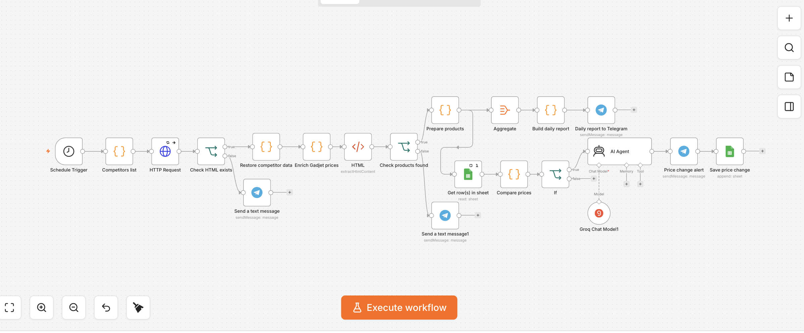

# n8n Automation & Integration Portfolio

Production-oriented case studies showing how business workflows can combine n8n, APIs, AI/LLMs, data stores, and operator-facing integrations.

The projects document validation, deterministic routing, structured model outputs, error handling, logging, known limitations, testing, and deployment considerations—not only successful workflow screenshots.

[Featured projects](#featured-case-studies) · [All case studies](#project-index) · [Engineering principles](#engineering-principles) · [Security and setup](#security-and-setup) · [Русская версия](#русская-версия)

## Start here: AI Booking System

The flagship case study is a modular booking and customer support system built from nine connected n8n workflows. It covers booking, rescheduling, cancellation, RAG FAQ, persistent conversations, and authorized administrator handoff.

Its engineering focus is explicit service boundaries: shared Calendar and Memory services, deterministic validation after AI interpretation, guarded handoff closure, and conditional rollback after notification failures. The documentation separates local checks from reported integration results and explains idempotency and concurrency limits.

**Stack:** `n8n` · `Supabase / PostgreSQL` · `Groq` · `Gemini` · `Telegram`

[Open AI Booking System](https://github.com/Andy-randy/ai-booking-system) · [Русская документация](https://github.com/Andy-randy/ai-booking-system/blob/main/README.ru.md)


## Featured case studies

### 1. AI Booking System

**Business use case:** manage the appointment lifecycle and customer questions through Telegram, with administrator support when needed.

**Engineering focus:** nine workflow contracts, persistent state and history, shared availability checks, RAG retrieval, administrator authorization, conditional close and notification-failure rollback.

**Stack:** `n8n` · `Supabase / PostgreSQL` · `Groq` · `Gemini` · `Telegram`

[Case study](https://github.com/Andy-randy/ai-booking-system) · [Русская документация](https://github.com/Andy-randy/ai-booking-system/blob/main/README.ru.md)

### 2. Barbershop Booking API

**Business use case:** accept booking requests, validate customer data, avoid ordinary retry duplicates, store the booking, and notify the manager and customer.

**Engineering focus:** sub-workflow boundaries, normalized idempotency key, non-blocking notifications, minimal error logs, and an honest account of Google Sheets concurrency limits.

**Stack:** `n8n` · `Webhooks` · `Google Sheets` · `Telegram Bot API` · `Gmail`

[Case study](https://github.com/Andy-randy/barbershop-booking-api)


### 3. RAG Telegram FAQ Bot

**Business use case:** index a controlled document and answer recurring Telegram questions from retrieved knowledge.

**Engineering focus:** separate ingestion and query paths, vector retrieval as an agent tool, deterministic `/start` routing, and explicit gaps around citations, relevance thresholds, and re-indexing.

**Stack:** `n8n` · `Supabase / pgvector` · `Hugging Face` · `Groq` · `Telegram`

[Case study](https://github.com/Andy-randy/rag-telegram-faq-bot)


### 4. AI Lead Processing Pipeline

**Business use case:** validate inbound leads, assess intent, and route hot, warm, and cold contacts to different sales actions.

**Engineering focus:** validation before AI, controlled model-output parsing, deterministic Switch routing, explicit AI-failure response, and channel-specific side effects.

**Stack:** `n8n` · `Groq` · `CRM REST API` · `Google Sheets` · `Telegram` · `Gmail`

[Case study](https://github.com/Andy-randy/ai-lead-processing-pipeline)


### 5. Competitor Price Monitoring

**Business use case:** monitor public product pages, compare observed prices with stored history, and alert operators to meaningful changes.

**Engineering focus:** separate fetch and extraction failures, deterministic numeric comparison, AI used only for explanation, and documented selector and legal risks.

**Stack:** `n8n` · `HTTP / HTML extraction` · `JavaScript` · `Groq` · `Google Sheets` · `Telegram`

[Case study](./05-competitor-price-monitoring/README.md)



## Project index

| # | Case study | Business use case | Key engineering signal |
| ---: | --- | --- | --- |
| 01 | [AI Sales Assistant](./01-ai-sales-assistant/README.md) | Collect booking details through a Telegram conversation | Short-term state plus deterministic completion routing |
| 02 | [AI Lead Processing Pipeline](https://github.com/Andy-randy/ai-lead-processing-pipeline) | Qualify and route sales leads | Guarded AI output and explicit branch responses |
| 03 | [Smart Vacancy Parser](./03-hh-parser/README.md) | Rank job opportunities and build review digests | Normalization plus deterministic and semantic gates |
| 04 | [RAG Telegram FAQ Bot](https://github.com/Andy-randy/rag-telegram-faq-bot) | Answer questions from an indexed knowledge source | Separate ingestion/query boundaries and retrieval constraints |
| 05 | [Competitor Price Monitoring](./05-competitor-price-monitoring/README.md) | Detect public price changes | Deterministic comparison with AI-only enrichment |
| 06 | [Fitness Club Lead Capture](./06-fitness-club-lead-capture/README.md) | Validate and distribute campaign leads | Reusable validation and conditional email path |
| 07 | [AI Service Request Automation](./07-ai-service-request-automation/README.md) | Triage appliance-repair requests | Strict urgency contract and operator-visible AI failures |
| 08 | [Barbershop Booking API](https://github.com/Andy-randy/barbershop-booking-api) | Create and notify on bookings | Modular API flow and practical idempotency boundary |
| 09 | [AI Booking System](https://github.com/Andy-randy/ai-booking-system) | Manage booking, rescheduling, cancellation, FAQ and administrator support | Stateful service orchestration, administrator authorization and conditional rollback |

Supporting workflow sketches live in [`experiments/`](./experiments/README.md). They are sanitized examples, not featured case studies.

## Engineering principles

- Use AI only where semantic judgment, retrieval, or summarization adds value.
- Keep validation, authentication, routing, and state transitions deterministic whenever possible.
- Parse and validate structured model outputs before they affect business actions.
- Define responsibility boundaries between intake, persistence, notification, and error handling.
- Retry only suitable external operations and document where retries are insufficient.
- Make failures visible through explicit responses, logs, and operator notifications.
- Publish sanitized, inactive workflow exports with `YOUR_*` placeholders.
- Document limitations such as non-atomic storage, missing availability checks, and model uncertainty.
- Treat examples and test scenarios as contracts, not decorative repository files.

## What the case studies demonstrate

### Workflow design

- webhook and Telegram intake;
- synchronous and asynchronous sub-workflows;
- deterministic IF and Switch routing;
- scheduled collection and batch processing;
- explicit success and failure responses.

### AI and data patterns

- LLM classification with controlled outputs;
- retrieval-augmented generation with a vector store;
- bounded conversation memory and persistent conversation state;
- semantic scoring combined with deterministic conditions;
- AI enrichment placed after deterministic change detection.

### Integration patterns

- Google Sheets as inspectable portfolio persistence;
- Telegram and Gmail notifications;
- CRM and generic REST API calls;
- Google Drive document ingestion;
- Supabase / PostgreSQL state storage, guarded database functions, and vector retrieval.

## Repository conventions

Full case studies follow a common structure where the project needs each artifact:

```text
project-name/
├── README.md
├── workflows/
├── screenshots/
├── examples/
└── tests/TEST_CASES.md
```

Every README is English-first and follows the same sequence: business problem, solution, architecture, evidence, decisions, contracts, failures, setup, tests, limitations, and production hardening.

## Security and setup

The public JSON exports are intentionally inactive. Credential mappings, webhook instance IDs, account-specific resource IDs, pinned execution data, and instance metadata have been removed.

To inspect a workflow safely:

1. read its README and limitations;
2. import it into a non-production n8n workspace;
3. attach credentials manually;
4. replace every `YOUR_*` value;
5. use synthetic test data;
6. run the documented scenarios before activation.

These projects are reference implementations, not one-click production deployments. Authentication, personal-data handling, retention, service quotas, and legal constraints must be adapted to the deployment context.

## Validation

The repository includes local checks for JSON parsing, inactive exports, removed metadata and credential mappings, public placeholders, workflow connection integrity, Markdown links and code fences, image media types, and public path naming.

```bash
node scripts/validate-portfolio.mjs
```

The [`scripts/sanitize-workflows.mjs`](./scripts/sanitize-workflows.mjs) script makes the public-export rules repeatable, but every diff still requires human review because automated sanitization cannot prove that arbitrary prompt text is non-sensitive.

## About

Built by [Daria Lesnikova](https://github.com/Andy-randy), focused on AI automation, API integration, and reliable business workflow design.

For project or collaboration discussions, use the contact links on the [GitHub profile](https://github.com/Andy-randy).

---

## Русская версия

Это портфолио production-oriented автоматизаций на n8n: API и webhook-интеграции, LLM-классификация, RAG, CRM-сценарии, Telegram/Gmail и работа с данными. В каждом полноценном кейсе показаны не только happy path, но и контракты, валидация, ошибки, тесты, ограничения и путь к production.

Основной проект — **[AI Booking System](https://github.com/Andy-randy/ai-booking-system)**: девять workflow для записи, переноса, отмены, RAG FAQ и передачи диалога администратору. В нём показаны постоянное состояние, общие сервисы расписания и памяти, проверка прав и условный rollback при ошибке уведомления. [Русская документация](https://github.com/Andy-randy/ai-booking-system/blob/main/README.ru.md).

Далее можно посмотреть **Barbershop Booking API**, **RAG Telegram FAQ Bot**, **AI Lead Processing Pipeline** и **Competitor Price Monitoring**. Подробные схемы, примеры и тестовые сценарии находятся в README соответствующих проектов.

Все публичные workflow выключены и санитизированы. Перед использованием нужно вручную подключить credentials, заменить placeholders и повторить тесты в отдельном n8n workspace.
